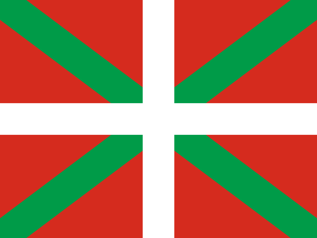
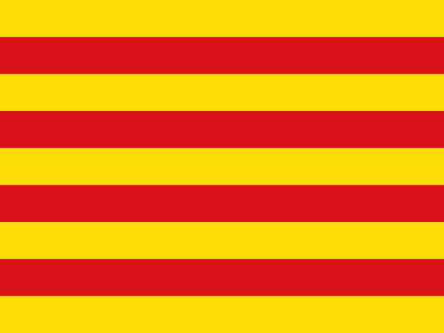
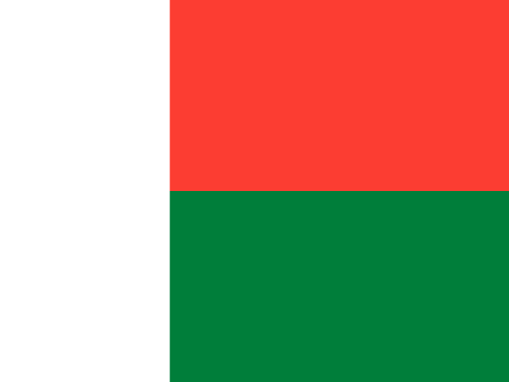
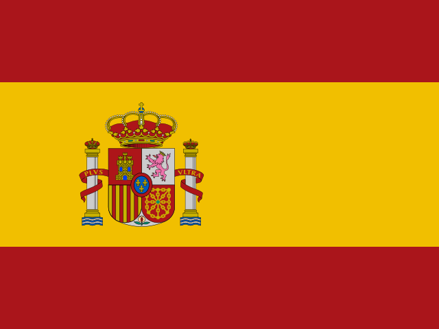
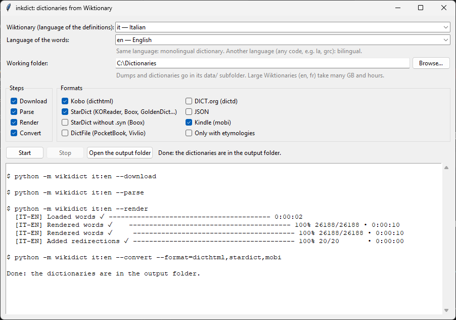

<h1 align="center">
  <picture>
    <source media="(prefers-color-scheme: dark)" srcset="assets/logo_dark.svg">
    
  </picture>
</h1>

Dictionaries for e-readers (Kobo, Kindle, KOReader, PocketBook, Boox...) built from [Wiktionary](https://www.wiktionary.org):

- **monolingual**: the words of a language explained in the same language (Italian words, in Italian);
- **bilingual**: the words of one language explained in another (English words, in Italian).

inkdict is a fork of [reader.dict's monolingual dictionaries](https://github.com/reader-dict/monolingual), by Mickaël Schoentgen and [its contributors](https://github.com/reader-dict/monolingual#contributors-), under the MIT license. It adds:

- bilingual dictionaries;
- a graphical interface, with launchers for Windows and for GNU/Linux and macOS;
- support for Windows (the code of the upstream project cannot be imported there).

<!-- toc:start (written by .github/scripts/update_readme.py) -->
**Contents**

- [Ready-made dictionaries](#ready-made-dictionaries)
- [How it works](#how-it-works)
- [Requirements](#requirements)
- [Graphical interface](#graphical-interface)
- [Command line](#command-line)
- [Output files](#output-files)
- [Supported Wiktionaries](#supported-wiktionaries)
- [Development](#development)
- [License](#license)
<!-- toc:end -->

## Ready-made dictionaries

This fork builds its dictionaries by itself and publishes them in its [Releases](https://github.com/6801318d8d/inkdict/releases), one release per dictionary, with instructions for each e-reader: the monolingual dictionary of each of the 30 [supported Wiktionaries](#supported-wiktionaries), and every bilingual pair among their languages (e.g. `dict-en-it`: English words explained in Italian). Pairs with fewer than 1,000 entries are not published.

Wiktionary publishes new dumps about twice a month. A daily [GitHub Actions workflow](.github/workflows/dictionaries.yml) rebuilds the dictionaries of each new dump, a few hours of work per Wiktionary every day until all are done, and replaces the release of the older dump. The languages are `LANGUAGES` in that workflow: a fork of this repository can build its own list the same way.

The list below links each published dictionary to its release; the workflow updates it after every build.

<!-- dictionaries:start (written by .github/scripts/update_readme.py) -->
265 dictionaries, grouped by the language of their words:

<details><summary> Basque (3)</summary>

-  [Monolingual](https://github.com/6801318d8d/inkdict/releases/tag/dict-eu-eu-20261101) (2026-11-01 dump)
-  [Basque-English](https://github.com/6801318d8d/inkdict/releases/tag/dict-eu-en-20261101) (2026-11-01 dump)
-  [Basque-Russian](https://github.com/6801318d8d/inkdict/releases/tag/dict-eu-ru-20261101) (2026-11-01 dump)

</details>

<details><summary> Bulgarian (6)</summary>

-  [Monolingual](https://github.com/6801318d8d/inkdict/releases/tag/dict-bg-bg-20261101) (2026-11-01 dump)
-  [Bulgarian-English](https://github.com/6801318d8d/inkdict/releases/tag/dict-bg-en-20261101) (2026-11-01 dump)
-  [Bulgarian-Japanese](https://github.com/6801318d8d/inkdict/releases/tag/dict-bg-ja-20261101) (2026-11-01 dump)
-  [Bulgarian-Korean](https://github.com/6801318d8d/inkdict/releases/tag/dict-bg-ko-20261101) (2026-11-01 dump)
-  [Bulgarian-Lithuanian](https://github.com/6801318d8d/inkdict/releases/tag/dict-bg-lt-20261101) (2026-11-01 dump)
-  [Bulgarian-Russian](https://github.com/6801318d8d/inkdict/releases/tag/dict-bg-ru-20261101) (2026-11-01 dump)

</details>

<details><summary> Catalan (7)</summary>

-  [Catalan-Basque](https://github.com/6801318d8d/inkdict/releases/tag/dict-ca-eu-20261101) (2026-11-01 dump)
-  [Catalan-English](https://github.com/6801318d8d/inkdict/releases/tag/dict-ca-en-20261101) (2026-11-01 dump)
-  [Catalan-Esperanto](https://github.com/6801318d8d/inkdict/releases/tag/dict-ca-eo-20261101) (2026-11-01 dump)
-  [Catalan-Japanese](https://github.com/6801318d8d/inkdict/releases/tag/dict-ca-ja-20261101) (2026-11-01 dump)
-  [Catalan-Lithuanian](https://github.com/6801318d8d/inkdict/releases/tag/dict-ca-lt-20261101) (2026-11-01 dump)
-  [Catalan-Romanian](https://github.com/6801318d8d/inkdict/releases/tag/dict-ca-ro-20261101) (2026-11-01 dump)
-  [Catalan-Russian](https://github.com/6801318d8d/inkdict/releases/tag/dict-ca-ru-20261101) (2026-11-01 dump)

</details>

<details><summary> Chinese (4)</summary>

-  [Chinese-Italian](https://github.com/6801318d8d/inkdict/releases/tag/dict-zh-it-20261101) (2026-11-01 dump)
-  [Chinese-Japanese](https://github.com/6801318d8d/inkdict/releases/tag/dict-zh-ja-20261101) (2026-11-01 dump)
-  [Chinese-Norwegian](https://github.com/6801318d8d/inkdict/releases/tag/dict-zh-no-20261101) (2026-11-01 dump)
-  [Chinese-Polish](https://github.com/6801318d8d/inkdict/releases/tag/dict-zh-pl-20261101) (2026-11-01 dump)

</details>

<details><summary> Czech (8)</summary>

-  [Monolingual](https://github.com/6801318d8d/inkdict/releases/tag/dict-cs-cs-20261101) (2026-11-01 dump)
-  [Czech-Basque](https://github.com/6801318d8d/inkdict/releases/tag/dict-cs-eu-20261101) (2026-11-01 dump)
-  [Czech-English](https://github.com/6801318d8d/inkdict/releases/tag/dict-cs-en-20261101) (2026-11-01 dump)
-  [Czech-Italian](https://github.com/6801318d8d/inkdict/releases/tag/dict-cs-it-20261101) (2026-11-01 dump)
-  [Czech-Japanese](https://github.com/6801318d8d/inkdict/releases/tag/dict-cs-ja-20261101) (2026-11-01 dump)
-  [Czech-Lithuanian](https://github.com/6801318d8d/inkdict/releases/tag/dict-cs-lt-20261101) (2026-11-01 dump)
-  [Czech-Romanian](https://github.com/6801318d8d/inkdict/releases/tag/dict-cs-ro-20261101) (2026-11-01 dump)
-  [Czech-Russian](https://github.com/6801318d8d/inkdict/releases/tag/dict-cs-ru-20261101) (2026-11-01 dump)

</details>

<details><summary> Danish (8)</summary>

-  [Monolingual](https://github.com/6801318d8d/inkdict/releases/tag/dict-da-da-20261101) (2026-11-01 dump)
-  [Danish-English](https://github.com/6801318d8d/inkdict/releases/tag/dict-da-en-20261101) (2026-11-01 dump)
-  [Danish-Esperanto](https://github.com/6801318d8d/inkdict/releases/tag/dict-da-eo-20261101) (2026-11-01 dump)
-  [Danish-Japanese](https://github.com/6801318d8d/inkdict/releases/tag/dict-da-ja-20261101) (2026-11-01 dump)
-  [Danish-Lithuanian](https://github.com/6801318d8d/inkdict/releases/tag/dict-da-lt-20261101) (2026-11-01 dump)
-  [Danish-Norwegian](https://github.com/6801318d8d/inkdict/releases/tag/dict-da-no-20261101) (2026-11-01 dump)
-  [Danish-Romanian](https://github.com/6801318d8d/inkdict/releases/tag/dict-da-ro-20261101) (2026-11-01 dump)
-  [Danish-Russian](https://github.com/6801318d8d/inkdict/releases/tag/dict-da-ru-20261101) (2026-11-01 dump)

</details>

<details><summary> Dutch (12)</summary>

-  [Dutch-Chinese](https://github.com/6801318d8d/inkdict/releases/tag/dict-nl-zh-20261101) (2026-11-01 dump)
-  [Dutch-Czech](https://github.com/6801318d8d/inkdict/releases/tag/dict-nl-cs-20261101) (2026-11-01 dump)
-  [Dutch-Danish](https://github.com/6801318d8d/inkdict/releases/tag/dict-nl-da-20261101) (2026-11-01 dump)
-  [Dutch-Esperanto](https://github.com/6801318d8d/inkdict/releases/tag/dict-nl-eo-20261101) (2026-11-01 dump)
-  [Dutch-Finnish](https://github.com/6801318d8d/inkdict/releases/tag/dict-nl-fi-20261101) (2026-11-01 dump)
-  [Dutch-Italian](https://github.com/6801318d8d/inkdict/releases/tag/dict-nl-it-20261101) (2026-11-01 dump)
-  [Dutch-Japanese](https://github.com/6801318d8d/inkdict/releases/tag/dict-nl-ja-20261101) (2026-11-01 dump)
-  [Dutch-Lithuanian](https://github.com/6801318d8d/inkdict/releases/tag/dict-nl-lt-20261101) (2026-11-01 dump)
-  [Dutch-Malagasy](https://github.com/6801318d8d/inkdict/releases/tag/dict-nl-mg-20261101) (2026-11-01 dump)
-  [Dutch-Polish](https://github.com/6801318d8d/inkdict/releases/tag/dict-nl-pl-20261101) (2026-11-01 dump)
-  [Dutch-Romanian](https://github.com/6801318d8d/inkdict/releases/tag/dict-nl-ro-20261101) (2026-11-01 dump)
-  [Dutch-Russian](https://github.com/6801318d8d/inkdict/releases/tag/dict-nl-ru-20261101) (2026-11-01 dump)

</details>

<details><summary> English (14)</summary>

-  [Monolingual](https://github.com/6801318d8d/inkdict/releases/tag/dict-en-en-20261101) (2026-11-01 dump)
-  [English-Basque](https://github.com/6801318d8d/inkdict/releases/tag/dict-en-eu-20261101) (2026-11-01 dump)
-  [English-Bulgarian](https://github.com/6801318d8d/inkdict/releases/tag/dict-en-bg-20261101) (2026-11-01 dump)
-  [English-Czech](https://github.com/6801318d8d/inkdict/releases/tag/dict-en-cs-20261101) (2026-11-01 dump)
-  [English-Danish](https://github.com/6801318d8d/inkdict/releases/tag/dict-en-da-20261101) (2026-11-01 dump)
-  [English-Esperanto](https://github.com/6801318d8d/inkdict/releases/tag/dict-en-eo-20261101) (2026-11-01 dump)
-  [English-Finnish](https://github.com/6801318d8d/inkdict/releases/tag/dict-en-fi-20261101) (2026-11-01 dump)
-  [English-Italian](https://github.com/6801318d8d/inkdict/releases/tag/dict-en-it-20261101) (2026-11-01 dump)
-  [English-Japanese](https://github.com/6801318d8d/inkdict/releases/tag/dict-en-ja-20261101) (2026-11-01 dump)
-  [English-Lithuanian](https://github.com/6801318d8d/inkdict/releases/tag/dict-en-lt-20261101) (2026-11-01 dump)
-  [English-Norwegian](https://github.com/6801318d8d/inkdict/releases/tag/dict-en-no-20261101) (2026-11-01 dump)
-  [English-Romanian](https://github.com/6801318d8d/inkdict/releases/tag/dict-en-ro-20261101) (2026-11-01 dump)
-  [English-Russian](https://github.com/6801318d8d/inkdict/releases/tag/dict-en-ru-20261101) (2026-11-01 dump)
-  [English-Thai](https://github.com/6801318d8d/inkdict/releases/tag/dict-en-th-20261101) (2026-11-01 dump)

</details>

<details><summary> Esperanto (11)</summary>

-  [Monolingual](https://github.com/6801318d8d/inkdict/releases/tag/dict-eo-eo-20261101) (2026-11-01 dump)
-  [Esperanto-Czech](https://github.com/6801318d8d/inkdict/releases/tag/dict-eo-cs-20261101) (2026-11-01 dump)
-  [Esperanto-English](https://github.com/6801318d8d/inkdict/releases/tag/dict-eo-en-20261101) (2026-11-01 dump)
-  [Esperanto-Finnish](https://github.com/6801318d8d/inkdict/releases/tag/dict-eo-fi-20261101) (2026-11-01 dump)
-  [Esperanto-Italian](https://github.com/6801318d8d/inkdict/releases/tag/dict-eo-it-20261101) (2026-11-01 dump)
-  [Esperanto-Japanese](https://github.com/6801318d8d/inkdict/releases/tag/dict-eo-ja-20261101) (2026-11-01 dump)
-  [Esperanto-Lithuanian](https://github.com/6801318d8d/inkdict/releases/tag/dict-eo-lt-20261101) (2026-11-01 dump)
-  [Esperanto-Norwegian](https://github.com/6801318d8d/inkdict/releases/tag/dict-eo-no-20261101) (2026-11-01 dump)
-  [Esperanto-Romanian](https://github.com/6801318d8d/inkdict/releases/tag/dict-eo-ro-20261101) (2026-11-01 dump)
-  [Esperanto-Russian](https://github.com/6801318d8d/inkdict/releases/tag/dict-eo-ru-20261101) (2026-11-01 dump)
-  [Esperanto-Thai](https://github.com/6801318d8d/inkdict/releases/tag/dict-eo-th-20261101) (2026-11-01 dump)

</details>

<details><summary> Finnish (11)</summary>

-  [Finnish-Basque](https://github.com/6801318d8d/inkdict/releases/tag/dict-fi-eu-20261101) (2026-11-01 dump)
-  [Finnish-Czech](https://github.com/6801318d8d/inkdict/releases/tag/dict-fi-cs-20261101) (2026-11-01 dump)
-  [Finnish-Danish](https://github.com/6801318d8d/inkdict/releases/tag/dict-fi-da-20261101) (2026-11-01 dump)
-  [Finnish-English](https://github.com/6801318d8d/inkdict/releases/tag/dict-fi-en-20261101) (2026-11-01 dump)
-  [Finnish-Esperanto](https://github.com/6801318d8d/inkdict/releases/tag/dict-fi-eo-20261101) (2026-11-01 dump)
-  [Finnish-Italian](https://github.com/6801318d8d/inkdict/releases/tag/dict-fi-it-20261101) (2026-11-01 dump)
-  [Finnish-Japanese](https://github.com/6801318d8d/inkdict/releases/tag/dict-fi-ja-20261101) (2026-11-01 dump)
-  [Finnish-Lithuanian](https://github.com/6801318d8d/inkdict/releases/tag/dict-fi-lt-20261101) (2026-11-01 dump)
-  [Finnish-Malagasy](https://github.com/6801318d8d/inkdict/releases/tag/dict-fi-mg-20261101) (2026-11-01 dump)
-  [Finnish-Romanian](https://github.com/6801318d8d/inkdict/releases/tag/dict-fi-ro-20261101) (2026-11-01 dump)
-  [Finnish-Russian](https://github.com/6801318d8d/inkdict/releases/tag/dict-fi-ru-20261101) (2026-11-01 dump)

</details>

<details><summary> French (15)</summary>

-  [French-Basque](https://github.com/6801318d8d/inkdict/releases/tag/dict-fr-eu-20261101) (2026-11-01 dump)
-  [French-Chinese](https://github.com/6801318d8d/inkdict/releases/tag/dict-fr-zh-20261101) (2026-11-01 dump)
-  [French-Czech](https://github.com/6801318d8d/inkdict/releases/tag/dict-fr-cs-20261101) (2026-11-01 dump)
-  [French-Danish](https://github.com/6801318d8d/inkdict/releases/tag/dict-fr-da-20261101) (2026-11-01 dump)
-  [French-English](https://github.com/6801318d8d/inkdict/releases/tag/dict-fr-en-20261101) (2026-11-01 dump)
-  [French-Esperanto](https://github.com/6801318d8d/inkdict/releases/tag/dict-fr-eo-20261101) (2026-11-01 dump)
-  [French-Finnish](https://github.com/6801318d8d/inkdict/releases/tag/dict-fr-fi-20261101) (2026-11-01 dump)
-  [French-Italian](https://github.com/6801318d8d/inkdict/releases/tag/dict-fr-it-20261101) (2026-11-01 dump)
-  [French-Japanese](https://github.com/6801318d8d/inkdict/releases/tag/dict-fr-ja-20261101) (2026-11-01 dump)
-  [French-Lithuanian](https://github.com/6801318d8d/inkdict/releases/tag/dict-fr-lt-20261101) (2026-11-01 dump)
-  [French-Malagasy](https://github.com/6801318d8d/inkdict/releases/tag/dict-fr-mg-20261101) (2026-11-01 dump)
-  [French-Norwegian](https://github.com/6801318d8d/inkdict/releases/tag/dict-fr-no-20261101) (2026-11-01 dump)
-  [French-Polish](https://github.com/6801318d8d/inkdict/releases/tag/dict-fr-pl-20261101) (2026-11-01 dump)
-  [French-Romanian](https://github.com/6801318d8d/inkdict/releases/tag/dict-fr-ro-20261101) (2026-11-01 dump)
-  [French-Russian](https://github.com/6801318d8d/inkdict/releases/tag/dict-fr-ru-20261101) (2026-11-01 dump)

</details>

<details><summary> German (12)</summary>

-  [German-Basque](https://github.com/6801318d8d/inkdict/releases/tag/dict-de-eu-20261101) (2026-11-01 dump)
-  [German-Czech](https://github.com/6801318d8d/inkdict/releases/tag/dict-de-cs-20261101) (2026-11-01 dump)
-  [German-Danish](https://github.com/6801318d8d/inkdict/releases/tag/dict-de-da-20261101) (2026-11-01 dump)
-  [German-English](https://github.com/6801318d8d/inkdict/releases/tag/dict-de-en-20261101) (2026-11-01 dump)
-  [German-Esperanto](https://github.com/6801318d8d/inkdict/releases/tag/dict-de-eo-20261101) (2026-11-01 dump)
-  [German-Finnish](https://github.com/6801318d8d/inkdict/releases/tag/dict-de-fi-20261101) (2026-11-01 dump)
-  [German-Italian](https://github.com/6801318d8d/inkdict/releases/tag/dict-de-it-20261101) (2026-11-01 dump)
-  [German-Japanese](https://github.com/6801318d8d/inkdict/releases/tag/dict-de-ja-20261101) (2026-11-01 dump)
-  [German-Lithuanian](https://github.com/6801318d8d/inkdict/releases/tag/dict-de-lt-20261101) (2026-11-01 dump)
-  [German-Norwegian](https://github.com/6801318d8d/inkdict/releases/tag/dict-de-no-20261101) (2026-11-01 dump)
-  [German-Romanian](https://github.com/6801318d8d/inkdict/releases/tag/dict-de-ro-20261101) (2026-11-01 dump)
-  [German-Russian](https://github.com/6801318d8d/inkdict/releases/tag/dict-de-ru-20261101) (2026-11-01 dump)

</details>

<details><summary> Greek (8)</summary>

-  [Greek-Czech](https://github.com/6801318d8d/inkdict/releases/tag/dict-el-cs-20261101) (2026-11-01 dump)
-  [Greek-English](https://github.com/6801318d8d/inkdict/releases/tag/dict-el-en-20261101) (2026-11-01 dump)
-  [Greek-Esperanto](https://github.com/6801318d8d/inkdict/releases/tag/dict-el-eo-20261101) (2026-11-01 dump)
-  [Greek-Finnish](https://github.com/6801318d8d/inkdict/releases/tag/dict-el-fi-20261101) (2026-11-01 dump)
-  [Greek-Japanese](https://github.com/6801318d8d/inkdict/releases/tag/dict-el-ja-20261101) (2026-11-01 dump)
-  [Greek-Lithuanian](https://github.com/6801318d8d/inkdict/releases/tag/dict-el-lt-20261101) (2026-11-01 dump)
-  [Greek-Romanian](https://github.com/6801318d8d/inkdict/releases/tag/dict-el-ro-20261101) (2026-11-01 dump)
-  [Greek-Russian](https://github.com/6801318d8d/inkdict/releases/tag/dict-el-ru-20261101) (2026-11-01 dump)

</details>

<details><summary> Italian (14)</summary>

-  [Monolingual](https://github.com/6801318d8d/inkdict/releases/tag/dict-it-it-20261101) (2026-11-01 dump)
-  [Italian-Basque](https://github.com/6801318d8d/inkdict/releases/tag/dict-it-eu-20261101) (2026-11-01 dump)
-  [Italian-Chinese](https://github.com/6801318d8d/inkdict/releases/tag/dict-it-zh-20261101) (2026-11-01 dump)
-  [Italian-Czech](https://github.com/6801318d8d/inkdict/releases/tag/dict-it-cs-20261101) (2026-11-01 dump)
-  [Italian-English](https://github.com/6801318d8d/inkdict/releases/tag/dict-it-en-20261101) (2026-11-01 dump)
-  [Italian-Esperanto](https://github.com/6801318d8d/inkdict/releases/tag/dict-it-eo-20261101) (2026-11-01 dump)
-  [Italian-Finnish](https://github.com/6801318d8d/inkdict/releases/tag/dict-it-fi-20261101) (2026-11-01 dump)
-  [Italian-Japanese](https://github.com/6801318d8d/inkdict/releases/tag/dict-it-ja-20261101) (2026-11-01 dump)
-  [Italian-Lithuanian](https://github.com/6801318d8d/inkdict/releases/tag/dict-it-lt-20261101) (2026-11-01 dump)
-  [Italian-Malagasy](https://github.com/6801318d8d/inkdict/releases/tag/dict-it-mg-20261101) (2026-11-01 dump)
-  [Italian-Polish](https://github.com/6801318d8d/inkdict/releases/tag/dict-it-pl-20261101) (2026-11-01 dump)
-  [Italian-Romanian](https://github.com/6801318d8d/inkdict/releases/tag/dict-it-ro-20261101) (2026-11-01 dump)
-  [Italian-Russian](https://github.com/6801318d8d/inkdict/releases/tag/dict-it-ru-20261101) (2026-11-01 dump)
-  [Italian-Thai](https://github.com/6801318d8d/inkdict/releases/tag/dict-it-th-20261101) (2026-11-01 dump)

</details>

<details><summary> Japanese (10)</summary>

-  [Monolingual](https://github.com/6801318d8d/inkdict/releases/tag/dict-ja-ja-20261101) (2026-11-01 dump)
-  [Japanese-Chinese](https://github.com/6801318d8d/inkdict/releases/tag/dict-ja-zh-20261101) (2026-11-01 dump)
-  [Japanese-Czech](https://github.com/6801318d8d/inkdict/releases/tag/dict-ja-cs-20261101) (2026-11-01 dump)
-  [Japanese-Finnish](https://github.com/6801318d8d/inkdict/releases/tag/dict-ja-fi-20261101) (2026-11-01 dump)
-  [Japanese-Italian](https://github.com/6801318d8d/inkdict/releases/tag/dict-ja-it-20261101) (2026-11-01 dump)
-  [Japanese-Lithuanian](https://github.com/6801318d8d/inkdict/releases/tag/dict-ja-lt-20261101) (2026-11-01 dump)
-  [Japanese-Malagasy](https://github.com/6801318d8d/inkdict/releases/tag/dict-ja-mg-20261101) (2026-11-01 dump)
-  [Japanese-Polish](https://github.com/6801318d8d/inkdict/releases/tag/dict-ja-pl-20261101) (2026-11-01 dump)
-  [Japanese-Romanian](https://github.com/6801318d8d/inkdict/releases/tag/dict-ja-ro-20261101) (2026-11-01 dump)
-  [Japanese-Russian](https://github.com/6801318d8d/inkdict/releases/tag/dict-ja-ru-20261101) (2026-11-01 dump)

</details>

<details><summary> Korean (8)</summary>

-  [Monolingual](https://github.com/6801318d8d/inkdict/releases/tag/dict-ko-ko-20261101) (2026-11-01 dump)
-  [Korean-Chinese](https://github.com/6801318d8d/inkdict/releases/tag/dict-ko-zh-20261101) (2026-11-01 dump)
-  [Korean-Italian](https://github.com/6801318d8d/inkdict/releases/tag/dict-ko-it-20261101) (2026-11-01 dump)
-  [Korean-Japanese](https://github.com/6801318d8d/inkdict/releases/tag/dict-ko-ja-20261101) (2026-11-01 dump)
-  [Korean-Lithuanian](https://github.com/6801318d8d/inkdict/releases/tag/dict-ko-lt-20261101) (2026-11-01 dump)
-  [Korean-Malagasy](https://github.com/6801318d8d/inkdict/releases/tag/dict-ko-mg-20261101) (2026-11-01 dump)
-  [Korean-Polish](https://github.com/6801318d8d/inkdict/releases/tag/dict-ko-pl-20261101) (2026-11-01 dump)
-  [Korean-Russian](https://github.com/6801318d8d/inkdict/releases/tag/dict-ko-ru-20261101) (2026-11-01 dump)

</details>

<details><summary> Latin (13)</summary>

-  [Monolingual](https://github.com/6801318d8d/inkdict/releases/tag/dict-la-la-20261101) (2026-11-01 dump)
-  [Latin-Chinese](https://github.com/6801318d8d/inkdict/releases/tag/dict-la-zh-20261101) (2026-11-01 dump)
-  [Latin-Czech](https://github.com/6801318d8d/inkdict/releases/tag/dict-la-cs-20261101) (2026-11-01 dump)
-  [Latin-Esperanto](https://github.com/6801318d8d/inkdict/releases/tag/dict-la-eo-20261101) (2026-11-01 dump)
-  [Latin-Finnish](https://github.com/6801318d8d/inkdict/releases/tag/dict-la-fi-20261101) (2026-11-01 dump)
-  [Latin-Italian](https://github.com/6801318d8d/inkdict/releases/tag/dict-la-it-20261101) (2026-11-01 dump)
-  [Latin-Japanese](https://github.com/6801318d8d/inkdict/releases/tag/dict-la-ja-20261101) (2026-11-01 dump)
-  [Latin-Lithuanian](https://github.com/6801318d8d/inkdict/releases/tag/dict-la-lt-20261101) (2026-11-01 dump)
-  [Latin-Malagasy](https://github.com/6801318d8d/inkdict/releases/tag/dict-la-mg-20261101) (2026-11-01 dump)
-  [Latin-Polish](https://github.com/6801318d8d/inkdict/releases/tag/dict-la-pl-20261101) (2026-11-01 dump)
-  [Latin-Romanian](https://github.com/6801318d8d/inkdict/releases/tag/dict-la-ro-20261101) (2026-11-01 dump)
-  [Latin-Russian](https://github.com/6801318d8d/inkdict/releases/tag/dict-la-ru-20261101) (2026-11-01 dump)
-  [Latin-Thai](https://github.com/6801318d8d/inkdict/releases/tag/dict-la-th-20261101) (2026-11-01 dump)

</details>

<details><summary> Lithuanian (7)</summary>

-  [Monolingual](https://github.com/6801318d8d/inkdict/releases/tag/dict-lt-lt-20261101) (2026-11-01 dump)
-  [Lithuanian-Basque](https://github.com/6801318d8d/inkdict/releases/tag/dict-lt-eu-20261101) (2026-11-01 dump)
-  [Lithuanian-Chinese](https://github.com/6801318d8d/inkdict/releases/tag/dict-lt-zh-20261101) (2026-11-01 dump)
-  [Lithuanian-Japanese](https://github.com/6801318d8d/inkdict/releases/tag/dict-lt-ja-20261101) (2026-11-01 dump)
-  [Lithuanian-Malagasy](https://github.com/6801318d8d/inkdict/releases/tag/dict-lt-mg-20261101) (2026-11-01 dump)
-  [Lithuanian-Polish](https://github.com/6801318d8d/inkdict/releases/tag/dict-lt-pl-20261101) (2026-11-01 dump)
-  [Lithuanian-Russian](https://github.com/6801318d8d/inkdict/releases/tag/dict-lt-ru-20261101) (2026-11-01 dump)

</details>

<details><summary>🌐 Lojban (1)</summary>

- 🌐 [Monolingual](https://github.com/6801318d8d/inkdict/releases/tag/dict-jbo-jbo-20261101) (2026-11-01 dump)

</details>

<details><summary> Malagasy (2)</summary>

-  [Malagasy-Polish](https://github.com/6801318d8d/inkdict/releases/tag/dict-mg-pl-20261101) (2026-11-01 dump)
-  [Malagasy-Russian](https://github.com/6801318d8d/inkdict/releases/tag/dict-mg-ru-20261101) (2026-11-01 dump)

</details>

<details><summary> Norwegian (8)</summary>

-  [Monolingual](https://github.com/6801318d8d/inkdict/releases/tag/dict-no-no-20261101) (2026-11-01 dump)
-  [Norwegian-Esperanto](https://github.com/6801318d8d/inkdict/releases/tag/dict-no-eo-20261101) (2026-11-01 dump)
-  [Norwegian-Finnish](https://github.com/6801318d8d/inkdict/releases/tag/dict-no-fi-20261101) (2026-11-01 dump)
-  [Norwegian-Lithuanian](https://github.com/6801318d8d/inkdict/releases/tag/dict-no-lt-20261101) (2026-11-01 dump)
-  [Norwegian-Malagasy](https://github.com/6801318d8d/inkdict/releases/tag/dict-no-mg-20261101) (2026-11-01 dump)
-  [Norwegian-Polish](https://github.com/6801318d8d/inkdict/releases/tag/dict-no-pl-20261101) (2026-11-01 dump)
-  [Norwegian-Romanian](https://github.com/6801318d8d/inkdict/releases/tag/dict-no-ro-20261101) (2026-11-01 dump)
-  [Norwegian-Russian](https://github.com/6801318d8d/inkdict/releases/tag/dict-no-ru-20261101) (2026-11-01 dump)

</details>

<details><summary> Polish (10)</summary>

-  [Polish-Chinese](https://github.com/6801318d8d/inkdict/releases/tag/dict-pl-zh-20261101) (2026-11-01 dump)
-  [Polish-Czech](https://github.com/6801318d8d/inkdict/releases/tag/dict-pl-cs-20261101) (2026-11-01 dump)
-  [Polish-Esperanto](https://github.com/6801318d8d/inkdict/releases/tag/dict-pl-eo-20261101) (2026-11-01 dump)
-  [Polish-Finnish](https://github.com/6801318d8d/inkdict/releases/tag/dict-pl-fi-20261101) (2026-11-01 dump)
-  [Polish-Italian](https://github.com/6801318d8d/inkdict/releases/tag/dict-pl-it-20261101) (2026-11-01 dump)
-  [Polish-Japanese](https://github.com/6801318d8d/inkdict/releases/tag/dict-pl-ja-20261101) (2026-11-01 dump)
-  [Polish-Lithuanian](https://github.com/6801318d8d/inkdict/releases/tag/dict-pl-lt-20261101) (2026-11-01 dump)
-  [Polish-Malagasy](https://github.com/6801318d8d/inkdict/releases/tag/dict-pl-mg-20261101) (2026-11-01 dump)
-  [Polish-Romanian](https://github.com/6801318d8d/inkdict/releases/tag/dict-pl-ro-20261101) (2026-11-01 dump)
-  [Polish-Russian](https://github.com/6801318d8d/inkdict/releases/tag/dict-pl-ru-20261101) (2026-11-01 dump)

</details>

<details><summary> Portuguese (12)</summary>

-  [Portuguese-Chinese](https://github.com/6801318d8d/inkdict/releases/tag/dict-pt-zh-20261101) (2026-11-01 dump)
-  [Portuguese-Esperanto](https://github.com/6801318d8d/inkdict/releases/tag/dict-pt-eo-20261101) (2026-11-01 dump)
-  [Portuguese-Finnish](https://github.com/6801318d8d/inkdict/releases/tag/dict-pt-fi-20261101) (2026-11-01 dump)
-  [Portuguese-Italian](https://github.com/6801318d8d/inkdict/releases/tag/dict-pt-it-20261101) (2026-11-01 dump)
-  [Portuguese-Japanese](https://github.com/6801318d8d/inkdict/releases/tag/dict-pt-ja-20261101) (2026-11-01 dump)
-  [Portuguese-Lithuanian](https://github.com/6801318d8d/inkdict/releases/tag/dict-pt-lt-20261101) (2026-11-01 dump)
-  [Portuguese-Malagasy](https://github.com/6801318d8d/inkdict/releases/tag/dict-pt-mg-20261101) (2026-11-01 dump)
-  [Portuguese-Norwegian](https://github.com/6801318d8d/inkdict/releases/tag/dict-pt-no-20261101) (2026-11-01 dump)
-  [Portuguese-Polish](https://github.com/6801318d8d/inkdict/releases/tag/dict-pt-pl-20261101) (2026-11-01 dump)
-  [Portuguese-Romanian](https://github.com/6801318d8d/inkdict/releases/tag/dict-pt-ro-20261101) (2026-11-01 dump)
-  [Portuguese-Russian](https://github.com/6801318d8d/inkdict/releases/tag/dict-pt-ru-20261101) (2026-11-01 dump)
-  [Portuguese-Thai](https://github.com/6801318d8d/inkdict/releases/tag/dict-pt-th-20261101) (2026-11-01 dump)

</details>

<details><summary> Romanian (8)</summary>

-  [Monolingual](https://github.com/6801318d8d/inkdict/releases/tag/dict-ro-ro-20261101) (2026-11-01 dump)
-  [Romanian-Chinese](https://github.com/6801318d8d/inkdict/releases/tag/dict-ro-zh-20261101) (2026-11-01 dump)
-  [Romanian-Finnish](https://github.com/6801318d8d/inkdict/releases/tag/dict-ro-fi-20261101) (2026-11-01 dump)
-  [Romanian-Japanese](https://github.com/6801318d8d/inkdict/releases/tag/dict-ro-ja-20261101) (2026-11-01 dump)
-  [Romanian-Lithuanian](https://github.com/6801318d8d/inkdict/releases/tag/dict-ro-lt-20261101) (2026-11-01 dump)
-  [Romanian-Malagasy](https://github.com/6801318d8d/inkdict/releases/tag/dict-ro-mg-20261101) (2026-11-01 dump)
-  [Romanian-Polish](https://github.com/6801318d8d/inkdict/releases/tag/dict-ro-pl-20261101) (2026-11-01 dump)
-  [Romanian-Russian](https://github.com/6801318d8d/inkdict/releases/tag/dict-ro-ru-20261101) (2026-11-01 dump)

</details>

<details><summary> Russian (10)</summary>

-  [Monolingual](https://github.com/6801318d8d/inkdict/releases/tag/dict-ru-ru-20261101) (2026-11-01 dump)
-  [Russian-Chinese](https://github.com/6801318d8d/inkdict/releases/tag/dict-ru-zh-20261101) (2026-11-01 dump)
-  [Russian-Finnish](https://github.com/6801318d8d/inkdict/releases/tag/dict-ru-fi-20261101) (2026-11-01 dump)
-  [Russian-Italian](https://github.com/6801318d8d/inkdict/releases/tag/dict-ru-it-20261101) (2026-11-01 dump)
-  [Russian-Japanese](https://github.com/6801318d8d/inkdict/releases/tag/dict-ru-ja-20261101) (2026-11-01 dump)
-  [Russian-Lithuanian](https://github.com/6801318d8d/inkdict/releases/tag/dict-ru-lt-20261101) (2026-11-01 dump)
-  [Russian-Malagasy](https://github.com/6801318d8d/inkdict/releases/tag/dict-ru-mg-20261101) (2026-11-01 dump)
-  [Russian-Polish](https://github.com/6801318d8d/inkdict/releases/tag/dict-ru-pl-20261101) (2026-11-01 dump)
-  [Russian-Romanian](https://github.com/6801318d8d/inkdict/releases/tag/dict-ru-ro-20261101) (2026-11-01 dump)
-  [Russian-Thai](https://github.com/6801318d8d/inkdict/releases/tag/dict-ru-th-20261101) (2026-11-01 dump)

</details>

<details><summary> Spanish (13)</summary>

-  [Spanish-Basque](https://github.com/6801318d8d/inkdict/releases/tag/dict-es-eu-20261101) (2026-11-01 dump)
-  [Spanish-Czech](https://github.com/6801318d8d/inkdict/releases/tag/dict-es-cs-20261101) (2026-11-01 dump)
-  [Spanish-Danish](https://github.com/6801318d8d/inkdict/releases/tag/dict-es-da-20261101) (2026-11-01 dump)
-  [Spanish-English](https://github.com/6801318d8d/inkdict/releases/tag/dict-es-en-20261101) (2026-11-01 dump)
-  [Spanish-Esperanto](https://github.com/6801318d8d/inkdict/releases/tag/dict-es-eo-20261101) (2026-11-01 dump)
-  [Spanish-Finnish](https://github.com/6801318d8d/inkdict/releases/tag/dict-es-fi-20261101) (2026-11-01 dump)
-  [Spanish-Italian](https://github.com/6801318d8d/inkdict/releases/tag/dict-es-it-20261101) (2026-11-01 dump)
-  [Spanish-Japanese](https://github.com/6801318d8d/inkdict/releases/tag/dict-es-ja-20261101) (2026-11-01 dump)
-  [Spanish-Lithuanian](https://github.com/6801318d8d/inkdict/releases/tag/dict-es-lt-20261101) (2026-11-01 dump)
-  [Spanish-Norwegian](https://github.com/6801318d8d/inkdict/releases/tag/dict-es-no-20261101) (2026-11-01 dump)
-  [Spanish-Romanian](https://github.com/6801318d8d/inkdict/releases/tag/dict-es-ro-20261101) (2026-11-01 dump)
-  [Spanish-Russian](https://github.com/6801318d8d/inkdict/releases/tag/dict-es-ru-20261101) (2026-11-01 dump)
-  [Spanish-Thai](https://github.com/6801318d8d/inkdict/releases/tag/dict-es-th-20261101) (2026-11-01 dump)

</details>

<details><summary> Swedish (12)</summary>

-  [Swedish-Chinese](https://github.com/6801318d8d/inkdict/releases/tag/dict-sv-zh-20261101) (2026-11-01 dump)
-  [Swedish-Danish](https://github.com/6801318d8d/inkdict/releases/tag/dict-sv-da-20261101) (2026-11-01 dump)
-  [Swedish-Esperanto](https://github.com/6801318d8d/inkdict/releases/tag/dict-sv-eo-20261101) (2026-11-01 dump)
-  [Swedish-Finnish](https://github.com/6801318d8d/inkdict/releases/tag/dict-sv-fi-20261101) (2026-11-01 dump)
-  [Swedish-Italian](https://github.com/6801318d8d/inkdict/releases/tag/dict-sv-it-20261101) (2026-11-01 dump)
-  [Swedish-Japanese](https://github.com/6801318d8d/inkdict/releases/tag/dict-sv-ja-20261101) (2026-11-01 dump)
-  [Swedish-Lithuanian](https://github.com/6801318d8d/inkdict/releases/tag/dict-sv-lt-20261101) (2026-11-01 dump)
-  [Swedish-Malagasy](https://github.com/6801318d8d/inkdict/releases/tag/dict-sv-mg-20261101) (2026-11-01 dump)
-  [Swedish-Norwegian](https://github.com/6801318d8d/inkdict/releases/tag/dict-sv-no-20261101) (2026-11-01 dump)
-  [Swedish-Polish](https://github.com/6801318d8d/inkdict/releases/tag/dict-sv-pl-20261101) (2026-11-01 dump)
-  [Swedish-Russian](https://github.com/6801318d8d/inkdict/releases/tag/dict-sv-ru-20261101) (2026-11-01 dump)
-  [Swedish-Thai](https://github.com/6801318d8d/inkdict/releases/tag/dict-sv-th-20261101) (2026-11-01 dump)

</details>

<details><summary> Thai (6)</summary>

-  [Monolingual](https://github.com/6801318d8d/inkdict/releases/tag/dict-th-th-20261101) (2026-11-01 dump)
-  [Thai-Chinese](https://github.com/6801318d8d/inkdict/releases/tag/dict-th-zh-20261101) (2026-11-01 dump)
-  [Thai-Japanese](https://github.com/6801318d8d/inkdict/releases/tag/dict-th-ja-20261101) (2026-11-01 dump)
-  [Thai-Malagasy](https://github.com/6801318d8d/inkdict/releases/tag/dict-th-mg-20261101) (2026-11-01 dump)
-  [Thai-Polish](https://github.com/6801318d8d/inkdict/releases/tag/dict-th-pl-20261101) (2026-11-01 dump)
-  [Thai-Russian](https://github.com/6801318d8d/inkdict/releases/tag/dict-th-ru-20261101) (2026-11-01 dump)

</details>

<details><summary> Turkish (6)</summary>

-  [Turkish-Chinese](https://github.com/6801318d8d/inkdict/releases/tag/dict-tr-zh-20261101) (2026-11-01 dump)
-  [Turkish-Finnish](https://github.com/6801318d8d/inkdict/releases/tag/dict-tr-fi-20261101) (2026-11-01 dump)
-  [Turkish-Lithuanian](https://github.com/6801318d8d/inkdict/releases/tag/dict-tr-lt-20261101) (2026-11-01 dump)
-  [Turkish-Malagasy](https://github.com/6801318d8d/inkdict/releases/tag/dict-tr-mg-20261101) (2026-11-01 dump)
-  [Turkish-Polish](https://github.com/6801318d8d/inkdict/releases/tag/dict-tr-pl-20261101) (2026-11-01 dump)
-  [Turkish-Russian](https://github.com/6801318d8d/inkdict/releases/tag/dict-tr-ru-20261101) (2026-11-01 dump)

</details>

<details><summary> Ukrainian (6)</summary>

-  [Ukrainian-Finnish](https://github.com/6801318d8d/inkdict/releases/tag/dict-uk-fi-20261101) (2026-11-01 dump)
-  [Ukrainian-Japanese](https://github.com/6801318d8d/inkdict/releases/tag/dict-uk-ja-20261101) (2026-11-01 dump)
-  [Ukrainian-Malagasy](https://github.com/6801318d8d/inkdict/releases/tag/dict-uk-mg-20261101) (2026-11-01 dump)
-  [Ukrainian-Polish](https://github.com/6801318d8d/inkdict/releases/tag/dict-uk-pl-20261101) (2026-11-01 dump)
-  [Ukrainian-Russian](https://github.com/6801318d8d/inkdict/releases/tag/dict-uk-ru-20261101) (2026-11-01 dump)
-  [Ukrainian-Thai](https://github.com/6801318d8d/inkdict/releases/tag/dict-uk-th-20261101) (2026-11-01 dump)

</details>

<!-- dictionaries:end -->

Ready-made monolingual dictionaries are also built by the upstream project, on [reader.dict](https://www.reader-dict.com).

## How it works

Each Wiktionary is written in one language but describes the words of many languages, each in its own section of the page. For example the page [house](https://it.wiktionary.org/wiki/house) of the Italian Wiktionary has an English section, with Italian definitions.

- A **monolingual** dictionary keeps, from a Wiktionary, the sections of its own language: from the Italian Wiktionary, the Italian words.
- A **bilingual** dictionary keeps the sections of another language: from the Italian Wiktionary, the English words, explained in Italian.

A dictionary is named by a *locale*: `it` for the monolingual Italian dictionary, `it:en` for the bilingual one (the Wiktionary, then the language of the words).

The work goes in four steps:

1. **download** the latest dump of the Wiktionary (all its pages, as one compressed XML file);
2. **parse** it into a database, shared by every dictionary built from that Wiktionary;
3. **render** the words of the chosen language: their definitions, pronunciations, etymologies and variants;
4. **convert** them into the dictionary formats of the e-readers.

Size and time grow with the Wiktionary. As an example, measured on a laptop with 12 cores: the Italian Wiktionary is a 72 MB download and a 370 MB database; rendering its 540,000 pages for the monolingual dictionary took 2 minutes, and its 26,000 English words (`it:en`) a few seconds. The English and French Wiktionaries are much larger: count several GB of disk space and hours of work.

## Requirements

- [uv](https://docs.astral.sh/uv/getting-started/installation/), which installs Python 3.13 and the other requirements by itself:
  - Windows: `powershell -ExecutionPolicy ByPass -c "irm https://astral.sh/uv/install.ps1 | iex"`
  - GNU/Linux and macOS: `curl -LsSf https://astral.sh/uv/install.sh | sh`
- [git](https://git-scm.com/downloads), to install one of the requirements.
- For Kindle dictionaries only: [kindling](https://github.com/ciscoriordan/kindling/releases), saved as `~/.local/bin/kindling` (GNU/Linux, macOS) or `%USERPROFILE%\.local\bin\kindling.exe` (Windows):
  - Windows: download `kindling-cli-windows.exe` and rename it `kindling.exe`;
  - GNU/Linux: download `kindling-cli-linux`, rename it `kindling`, and run `chmod a+x ~/.local/bin/kindling`;
  - macOS: the same with `kindling-cli-mac-apple-silicon` or `kindling-cli-mac-intel`.

Then download this project: `git clone https://github.com/6801318d8d/inkdict.git`, or *Code → Download ZIP* on GitHub.

## Graphical interface



- Windows: double-click `start_gui.bat`.
- GNU/Linux and macOS: run `./start_gui.sh` in a terminal.

The first start takes a minute or two, while uv installs Python and the requirements; the next ones are quick.

In the window:

1. **Wiktionary**: the language of the definitions.
2. **Language of the words**: the same language for a monolingual dictionary, another one for a bilingual dictionary. Any language code can be typed (`la`, `grc`, `ja`...), as long as that Wiktionary has words in it.
3. **Working folder**: the dumps and the dictionaries go in its `data/` subfolder, the logs in its `logs/` subfolder.
4. **Steps** and **Formats**: all the steps are needed the first time; afterwards, another dictionary from the same dump needs only *Render* and *Convert*. *Only with etymologies* skips the variant of each dictionary without etymologies.
5. **Start**. The output of each step is shown in the window; **Stop** interrupts it, and **Open the output folder** shows the dictionaries.

## Command line

Install the requirements once, in the project folder, and activate the environment:

```bash
uv venv --python 3.13
uv pip install -r requirements.txt

# GNU/Linux and macOS
. .venv/bin/activate
# Windows
.venv\Scripts\activate
```

Then run `python -m wikidict LOCALE` for all the steps, or one step at a time:

```bash
# Monolingual: Italian words, in Italian
python -m wikidict it --download
python -m wikidict it --parse
python -m wikidict it --render
python -m wikidict it --convert

# Bilingual: English words, in Italian (the dump and the database are those of `it`)
python -m wikidict it:en --render
python -m wikidict it:en --convert
```

Useful options:

- `--convert --format=stardict,dicthtml` makes only some formats (`dictfile`, `dicthtml`, `dictorg`, `jsonvolume`, `mobi`, `stardict`, `stardict-nosyn`, or `all`), and `--with-etym-only` skips the variants without etymologies;
- `--render --workers=4` limits the number of processes;
- `--get-word=WORD` shows how one word is rendered, straight from Wiktionary (after `--download`): `python -m wikidict it:en --get-word=cat`.

The data go to the `data/` folder of the current folder, or of the folder named by the `CWD` environment variable. [DEBUG.md](DEBUG.md) lists the variables that help to debug a dictionary.

## Output files

The dictionaries are in `data/<words>/<wiktionary>/output/`: `data/it/it/output/` for `it`, `data/en/it/output/` for `it:en`. Their names give the language of the words first, then the language of the definitions, as e-readers expect: `it:en` gives `dict-en-it.zip`, offered for books in English. Each comes in two variants, with and without (`-noetym`) etymologies.

| File | Format | Devices and apps |
|------|--------|------------------|
| `dicthtml-en-it.zip` | Kobo | Kobo: copy it, as it is, into the `.kobo/custom-dict/` folder of the e-reader |
| `dict-en-it.zip` | StarDict | KOReader: unzip it into `koreader/data/dict/`; also GoldenDict, Boox... |
| `dict-en-it-nosyn.zip` | StarDict without the `.syn` file | Readers that ignore that file (Boox) |
| `dict-en-it.mobi.zip` | Mobipocket | Kindle: unzip it, and copy the `.mobi` file into `documents/dictionaries/` |
| `dict-en-it.df.bz2` | DictFile | PocketBook, Vivlio (through their converters) |
| `dictorg-en-it.zip` | DICT.org | dictd and its clients |
| `jsonvolume/` | JSON | Other uses |

More instructions for each device are on [reader.dict](https://www.reader-dict.com).

## Supported Wiktionaries

Monolingual dictionaries can be built from 30 Wiktionaries: `bg`, `ca`, `cs`, `da`, `de`, `el`, `en`, `eo`, `es`, `eu`, `fi`, `fr`, `it`, `ja`, `jbo`, `ko`, `la`, `lt`, `mg`, `nl`, `no`, `pl`, `pt`, `ro`, `ru`, `sv`, `th`, `tr`, `uk`, `zh`.

Bilingual dictionaries can be built from all of them except the Lojban one (`jbo`). Each Wiktionary marks the section of a language in its own way: `foreign_head_sections`, in `wikidict/lang/<code>/__init__.py`, describes it with placeholders for the language of the words: `$code` (`en`), `$code3` (`eng`) and `$name` (the name of the language in the Wiktionary's own language: `anglais` in the French one). For example `("{{langue|$code}}",)` for the French Wiktionary, `("$name",)` for the English one.

So far only `it:en` has been built and checked end to end; the other pairs follow the same rules but have not been checked yet. If a pair gives few or no words, please open an issue.

## Development

Run the tests:

```bash
uv pip install -r requirements-tests.txt

# The tests of a language (and the bilingual ones, for `it`) need the dump of its Wiktionary
python -m wikidict it --download
python -m wikidict it --parse
python -m pytest tests/test_it.py tests/test_bilingual.py

# Doctests
python -m pytest --doctest-modules wikidict
```

Run the linters and the type checker before a pull request: `./check.sh`.

The changes from the upstream project are described in the commits of this fork; the upstream updates can be merged with `git pull https://github.com/reader-dict/monolingual.git main`.

## License

MIT: see [LICENSE](LICENSE). The dictionaries contain text from Wiktionary, available under the [Creative Commons Attribution-ShareAlike license](https://creativecommons.org/licenses/by-sa/4.0/).
